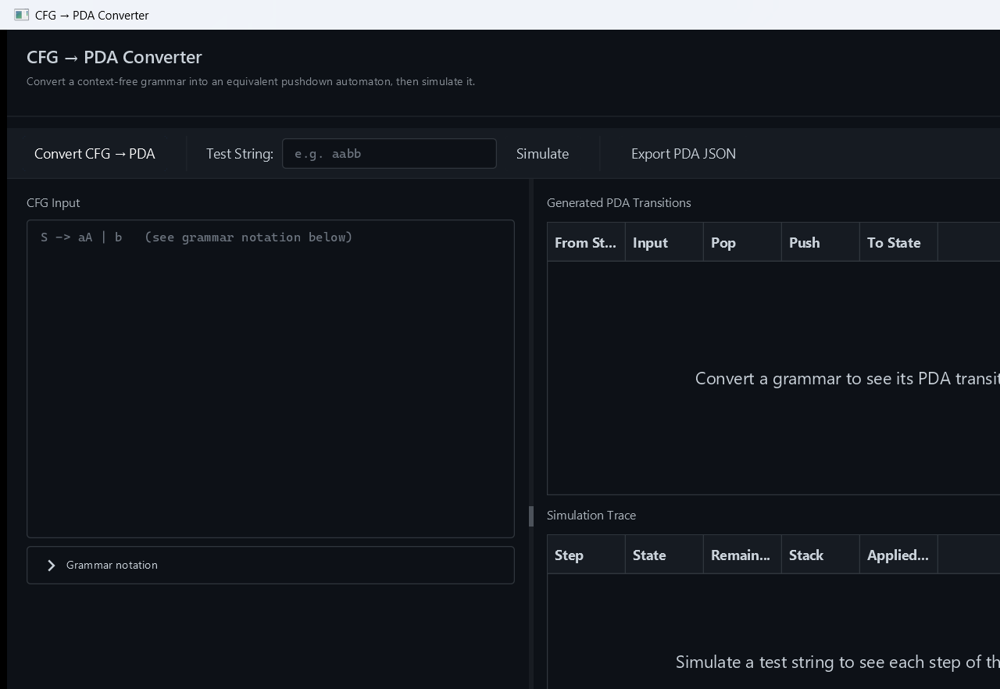
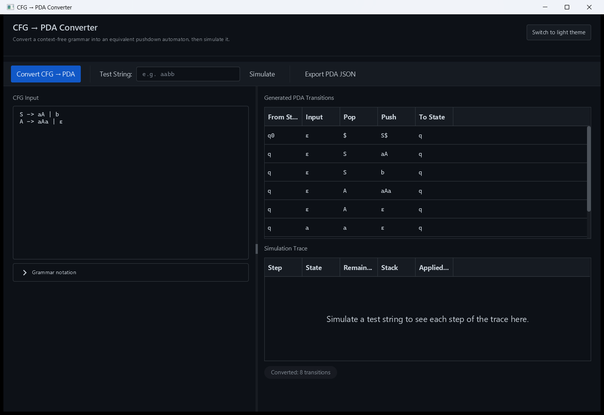
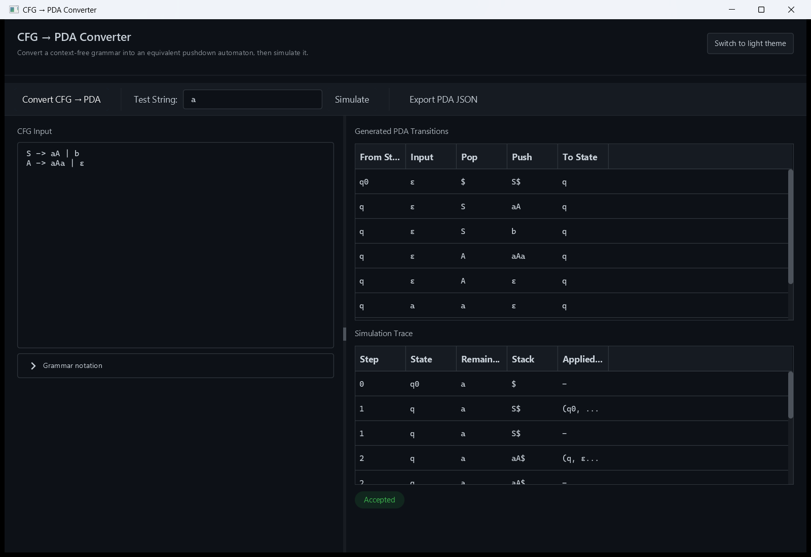
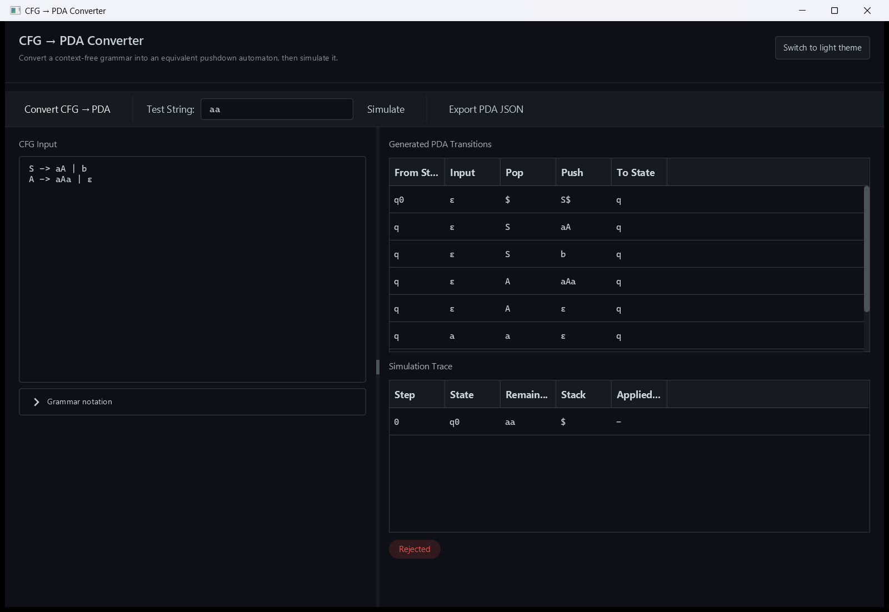
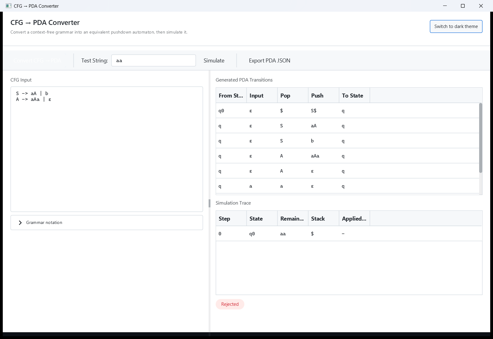
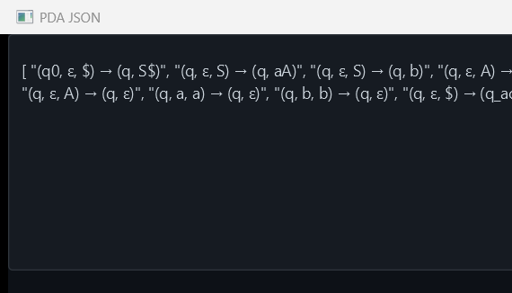

# CFG → PDA Converter


A desktop tool that converts a **context-free grammar (CFG)** into an equivalent
**pushdown automaton (PDA)** and simulates the PDA against test strings, step by
step. Built as a teaching aid for a Theory of Computation / Automata Theory
course.

## Overview

Given a context-free grammar written as a list of productions, the app:

1. Parses the grammar into nonterminals, terminals, and productions.
2. Validates it (e.g. the start symbol must be a declared nonterminal).
3. Converts it into a pushdown automaton using the standard top-down
   (greibach-free) single-state construction.
4. Simulates the PDA on a test string via depth-first search over
   nondeterministic transitions, and shows whether the string is accepted,
   along with every step of the trace (state, remaining input, stack
   contents, and the transition applied).

This mirrors the textbook proof that every context-free language is accepted
by some pushdown automaton — the app builds that automaton for you and lets
you watch it run.

## Features

- **Grammar input** with a simple, readable notation (`S -> aA | b`, `ε` for
  the empty string).
- **One-click conversion** from CFG to PDA, shown as a transition table
  (from-state, input, pop, push, to-state).
- **Step-by-step simulation** of any test string, with an accept/reject
  verdict and the full derivation trace.
- **Export to JSON** for the generated PDA transitions.
- **Light/dark theme toggle** (AtlantaFX Primer themes).
- Input validation with inline, human-readable error messages instead of
  silent failures.

## Screenshots

| | |
|---|---|
|  |  |
| **Home — empty state** | **Convert: grammar → PDA transitions** |
|  |  |
| **Simulate: accepted string** | **Simulate: rejected string** |
|  |  |
| **Light theme** | **Export PDA as JSON** |

## Tech stack

- **Language:** Java 17
- **UI:** JavaFX 21.0.3 (FXML + CSS), themed with [AtlantaFX](https://github.com/mkpaz/atlantafx) 2.0.1 (Primer Light/Dark)
- **JSON:** Jackson Databind 2.17.1
- **Testing:** JUnit Jupiter 5.10.2
- **Build:** Maven, with `javafx-maven-plugin` and `exec-maven-plugin`

## Project structure

```
cft2pda/
├── pom.xml                          # Maven build config
├── settings.xml                     # Local Maven settings used for builds
├── src/
│   ├── main/
│   │   ├── java/com/hassan/cfg2pda/
│   │   │   ├── MainApp.java         # JavaFX entry point, theme switching
│   │   │   ├── controller/          # FXML controller (UI <-> logic glue)
│   │   │   ├── model/               # CFG, PDA, Production, PDATransition
│   │   │   ├── parse/               # CFGParser — text -> CFG model
│   │   │   ├── validate/            # CFGValidator — grammar sanity checks
│   │   │   ├── converter/           # CFGToPDAConverter — CFG -> PDA
│   │   │   ├── simulate/            # PDASimulator — DFS acceptance + trace
│   │   │   └── util/                # JsonUtil — JSON export helper
│   │   └── resources/
│   │       ├── view/MainView.fxml   # UI layout
│   │       └── styles/app.css       # Custom styling on top of AtlantaFX
│   └── test/java/com/hassan/cfg2pda/
│       ├── CFGParserTest.java
│       ├── ConverterTest.java
│       └── PDASimulatorTest.java
└── docs/screenshots/                # Screenshots used in this README
```

## Prerequisites

- JDK 17 or newer
- Maven 3.9+ (a local `settings.xml` is included; no external repository
  credentials are required)

## Build & run

```bash
# Clean build + run the test suite
mvn clean test

# Launch the GUI
mvn javafx:run
```

## How to use

1. Type a grammar into the **CFG Input** box, one nonterminal's productions
   per line, e.g.:
   ```
   S -> aA | b
   A -> aAa | ε
   ```
   Uppercase symbols are nonterminals, lowercase are terminals, `|` separates
   alternatives, and `ε` (or the word `epsilon`) denotes the empty string.
2. Click **Convert CFG → PDA** to generate the PDA's transition table.
3. Type a string into **Test String** and click **Simulate** to see whether
   it's accepted, with the full step-by-step trace.
4. Click **Export PDA JSON** to view the transitions as JSON.
5. Use the theme button in the top-right to switch between light and dark.

## Testing

```bash
mvn test
```

Covers the parser (including nonterminal/terminal tokenization edge cases),
the CFG→PDA converter, and the PDA simulator (acceptance, rejection, and a
regression test for the restart-exploit bug described below).

## Restoration notes

This project was restored and modernized from an archived university
assignment. It already built and ran cleanly; the work here focused on
correctness and polish rather than a rewrite:

**Bugs fixed:**
- **Parser tokenization bug:** `CFGParser.tokenize()` greedily consumed any
  letter or digit after an uppercase character, so a production like
  `A -> aAa` was mis-split into terminal `a` + nonterminal `Aa` instead of
  `a`, `A`, `a` — silently corrupting the exact example grammar shown in the
  app's own notes. Fixed so a nonterminal name only continues on digits/`_`.
- **PDA restart-exploit bug:** the initial transition `(q, ε, $) → (q, S$)`
  ran from the same working state `q` it never left, so the simulator could
  "replay" it whenever the stack emptied back to `$` mid-string — allowing
  it to wrongly accept concatenations of independently-valid substrings
  (e.g. `"aa"` as `"a" + "a"`). Fixed by introducing a dedicated start state
  `q0` with no incoming transitions, so the init step can only fire once.
- Removed orphaned React scaffolding (`src/App.jsx`, `src/main.jsx`,
  `src/App.css`, `src/index.css`, `src/assets/react.svg`,
  `src/components/{Task,User,Users}.jsx`) — leftover files with no
  `package.json` or build tooling anywhere in the repo, completely
  disconnected from the Java/Maven application.

**GUI modernization:**
- Added [AtlantaFX](https://github.com/mkpaz/atlantafx) for a modern,
  professional Primer Light/Dark theme with a runtime toggle.
- Redesigned the layout with a header bar, clearer section labels, monospace
  typography for grammar/transition/trace data (where symbol alignment
  matters), colored accept/reject status chips, and inline validation
  messages with empty-state placeholders in both tables.
- No business logic was duplicated or altered in the controller beyond
  calling the existing parser/validator/converter/simulator classes.

## Known limitations & future improvements

- The PDA simulator explores derivations via unbounded depth-first search
  (capped at 800 steps); highly ambiguous or deeply left-recursive grammars
  can be slow to simulate.
- No support for grammars requiring CNF/Greibach normal-form preprocessing —
  conversion uses the general top-down construction directly.
- Export is JSON-only; no PDA diagram/visual rendering yet.

## Author

**Hassan** — [GitHub](https://github.com/your-username) · [LinkedIn](https://linkedin.com/in/your-profile)

## License

MIT — see [LICENSE](LICENSE).
